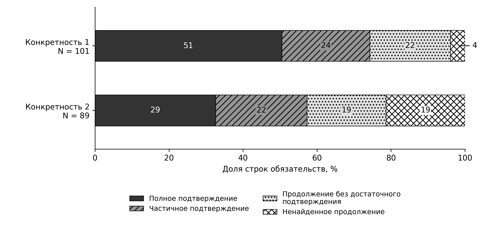

# Figure 1 · Исходы по конкретности

{width=6.3in}

Данные: F2, C-primary; числа внутри сегментов — n, рядом с группами — N; ширины по точным n/N. Исходы корпоративного раскрытия при неодинаковом горизонте. Аудит исходного F: при конкретности 2 partial 21→22, dropped 20→19, full 29 без изменения. Чёрно-белое построение кодом по существующим данным; это не генеративное изображение и не причинная диаграмма.
