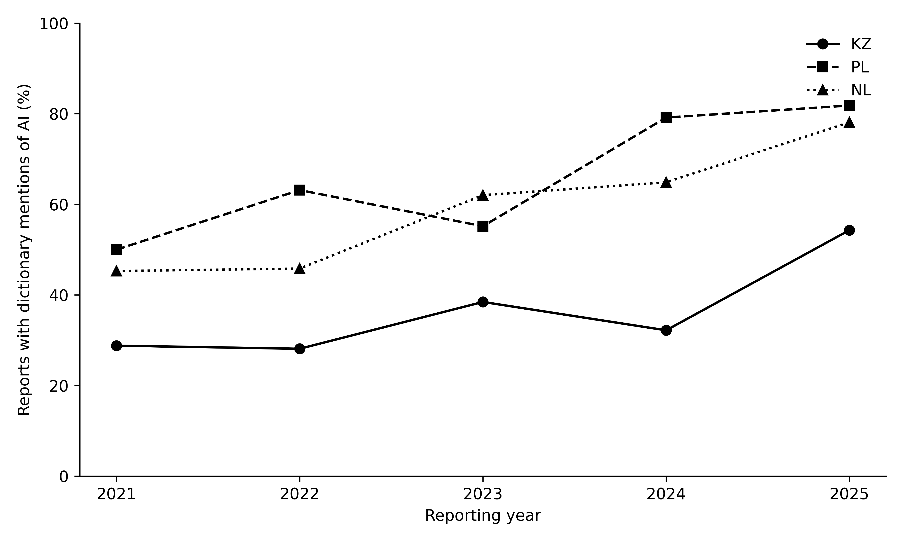

### Supplementary Figure S1. Dictionary mentions of AI in the original report panel

Reports with dictionary matches in the original 1,098-report panel, with annual country-specific denominators: KZ: 2021: 17/59, 2022: 18/64, 2023: 25/65, 2024: 38/118, 2025: 63/116; PL: 2021: 15/30, 2022: 12/19, 2023: 16/29, 2024: 19/24, 2025: 27/33; NL: 2021: 48/106, 2022: 55/120, 2023: 67/108, 2024: 72/111, 2025: 75/96. The composition changes between years; four texts designated unusable during subsequent-report matching remain in this source panel. Matches may reflect extraction damage. This figure describes retrieval, not AI adoption, a fixed company cohort or commitment outcomes. It is not evidence for the specificity association. F3 changes commitment outcomes, not this source panel. Source: original report panel.

[Vector PDF](Supplementary_Figure_S1.pdf).
